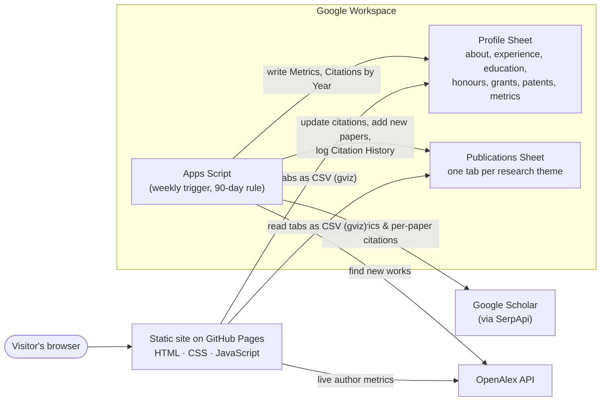

# Academic Profile — Prof. Syed Mohammed Basheeruddin Asdaq

**Live site:** https://smbasdaq.github.io

The official academic profile of **Prof. Syed Mohammed Basheeruddin Asdaq**: Professor, College of Pharmacy; Director, Research Centre; and Head, Quality Unit, College of Pharmacy, AlMaarefa University, Riyadh, Saudi Arabia.

The site presents his career, research themes, about 350 publications, honours, grants, patents and research-impact analytics. It is a **static website with no backend**. All content lives in two Google Sheets that a non-technical owner can edit, and a scheduled Google Apps Script keeps the citation metrics up to date from Google Scholar and OpenAlex.

---

## Highlights

| | |
|---|---|
| **No-code content management** | Every word, date, link and paper comes from Google Sheets. Editing a cell and reloading the page updates the site, with no rebuild or redeploy. |
| **Automated research metrics** | A time-driven Apps Script refreshes Google Scholar citations, h-index, i10-index, per-year citations and **per-paper citation counts** every 90 days, and keeps a history of past counts. |
| **New-paper discovery** | Papers newly found on Google Scholar or OpenAlex are added to the sheet automatically, with a suggested research theme, and flagged for review. |
| **Live OpenAlex metrics** | Works count, citations and h-index are fetched from the OpenAlex API in the browser on every visit. |
| **Research themes** | 12 thematic tiles, each opening a lightbox list of papers with verified DOI links. |
| **Searchable publication list** | Full-text search with filters for theme, type and year, sorted by newest or most cited. |
| **Impact analytics** | Charts of citations per year, publications per year, papers by theme and citations by theme (Chart.js). |
| **Responsive and accessible** | Mobile, tablet and desktop layouts, light and dark themes, keyboard-navigable dialogs, and reduced-motion support. |
| **Zero hosting cost** | GitHub Pages for hosting, Google Sheets for data, Apps Script for automation. |

---

## Architecture



### How a page load works
1. The browser loads the static files from GitHub Pages.
2. `js/data.js` reads each sheet tab through the Google Visualization endpoint (`/gviz/tq?tqx=out:csv&sheet=<tab>`) and parses it with PapaParse.
3. Rows are cleaned, filtered by their `Show` column, and sorted newest first, with undated items last.
4. `js/main.js` renders every section, works out the per-theme paper and citation totals, and draws the charts.
5. OpenAlex metrics are requested live and shown next to the Google Scholar figures stored in the sheet.

### How the metrics stay current
The Apps Script runs once a week but calls the paid API only when **90 days** have passed since the last successful fetch, which is stored as a script property. A single run uses about 4 SerpApi searches. It then:
- updates the overall citation metrics and the citations-per-year series;
- matches every Scholar entry to its row in the Publications sheet by normalised title and updates that row's citation count. Per-theme totals on the site are calculated from these per-paper counts;
- appends each new count to a **Citation History** tab;
- queries OpenAlex and Scholar for works newer than the last fetch, skips supplements and non-research items, guesses a theme from keyword rules, and appends the paper highlighted for manual review.

The fetch date is saved only after a successful run, so a failed run is retried at the next weekly check.

---

## Tech stack

| Layer | Technology |
|---|---|
| Front end | HTML5, CSS (custom properties, grid, `<dialog>`), vanilla JavaScript (ES2020) |
| Libraries (vendored) | [PapaParse 5.4.1](https://www.papaparse.com/) for CSV parsing, [Chart.js 4.4.1](https://www.chartjs.org/) for charts, [SheetJS 0.18.5](https://sheetjs.com/) for the optional Excel data source |
| Data | Google Sheets (published read-only by link) |
| Automation | Google Apps Script with a time-driven trigger and script properties for secrets |
| External APIs | [SerpApi Google Scholar Author API](https://serpapi.com/google-scholar-author-api), [OpenAlex](https://openalex.org/) |
| Hosting | GitHub Pages |

There's no build step, framework or server, so the repository is exactly what is deployed.

---

## Repository structure

```
.
├── index.html                      Page structure and section containers
├── css/style.css                   Design tokens, light/dark themes, responsive layout
├── js/
│   ├── config.js                   Data source switch and Google Sheet IDs
│   ├── data.js                     Loads and normalises sheet tabs
│   ├── main.js                     Renders sections, lightbox, filters and charts
│   └── vendor/                     PapaParse, Chart.js, SheetJS (pinned versions)
├── images/                         Portrait, favicon, hero background pattern
├── docs/
│   ├── HOW-TO-EDIT.md              Editing guide for the content owner
│   ├── SOP-google-sheets.md        Standard operating procedure for the Google Sheets
│   └── google-apps-script/
│       └── scholar-metrics.gs      The metrics automation script
└── DEPLOY.md                       Step-by-step deployment guide
```

---

## Data model

The live data is available read-only:

| Sheet | Link |
|---|---|
| Publications | https://docs.google.com/spreadsheets/d/1jvSwGfHIs03pDiW7C_mBn9CwK1QIyX7HwgjBfSFLjwE/edit?usp=sharing |
| Profile | https://docs.google.com/spreadsheets/d/1YotZBevudLM0cHgZtnudn4NSi-PBkuUPaUGrVYPxJ38/edit?usp=drive_link |

**Publications Sheet**
- `Themes`: one row per research theme (`Code`, `Tab`, `Display Name`, `Description`, `Order`).
- One tab per theme, with the columns `Year`, `Title`, `Authors`, `Journal`, `Volume`, `Issue`, `Pages`, `DOI`, `Type`, `Citations`, `Citation Source`, `Show on Site`, and others.
- `Citation History`: dated log of per-paper citation counts, written by the script.

**Profile Sheet**

`About`, `Executive Profile`, `Impact at a Glance`, `Experience`, `Current Roles`, `Education`, `Honours`, `Editorial & Scholarly`, `Research Themes`, `Grants`, `Patents`, `Research Leadership`, `Teaching`, `Quality & Accreditation`, `Metrics`, `Citations by Year`, `Languages`, `Links`, `Emails`.

Tab names and header rows act as the schema. Any row can be hidden from the site by setting `Show` to `No`.

---

## Running locally

The site has to be served over HTTP rather than opened as a file:

```bash
git clone https://github.com/smbasdaq/smbasdaq.github.io.git
cd smbasdaq.github.io
python -m http.server 8000
# open http://localhost:8000
```

`js/config.js` also supports `source: "excel"`, which reads the same data from local `.xlsx` files, and `source: "csv"`. This makes it possible to work offline or keep a private copy of the data.

---

## Security and privacy

- **No secrets in this repository.** The SerpApi and OpenAlex keys are stored only as Apps Script *script properties* inside the owner's Google account.
- The Google Sheets are shared **view-only**, and editing rights are limited to the owner.
- Personal data such as referees and private contact details is kept out of the public sheets.
- All DOIs were verified against the doi.org handle registry before publication.

---

## Documentation

- [DEPLOY.md](DEPLOY.md): setting up the Sheets, GitHub Pages and the Apps Script trigger.
- [docs/HOW-TO-EDIT.md](docs/HOW-TO-EDIT.md): editing guide for the content owner.
- [docs/SOP-google-sheets.md](docs/SOP-google-sheets.md): rules for keeping the sheets consistent.

---

## Credits

Designed and developed by **[Emaduddin Asdaq](https://github.com/EMADUDDINAsdaq)**, with AI-assisted development using Claude (Anthropic).

Content © Prof. Syed Mohammed Basheeruddin Asdaq. All rights reserved. Publication metadata comes from Google Scholar, OpenAlex and Crossref.
